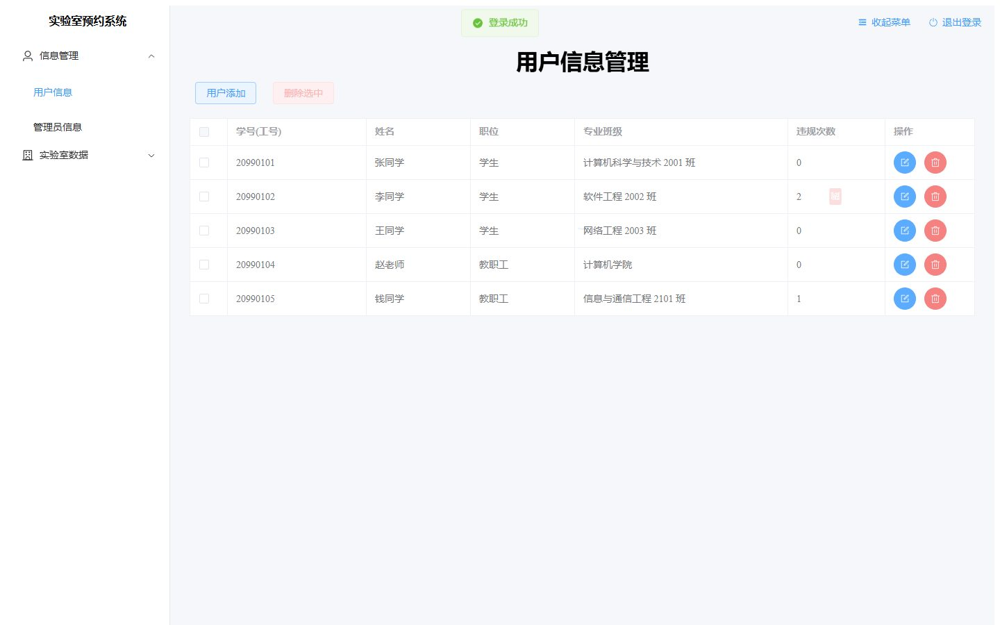
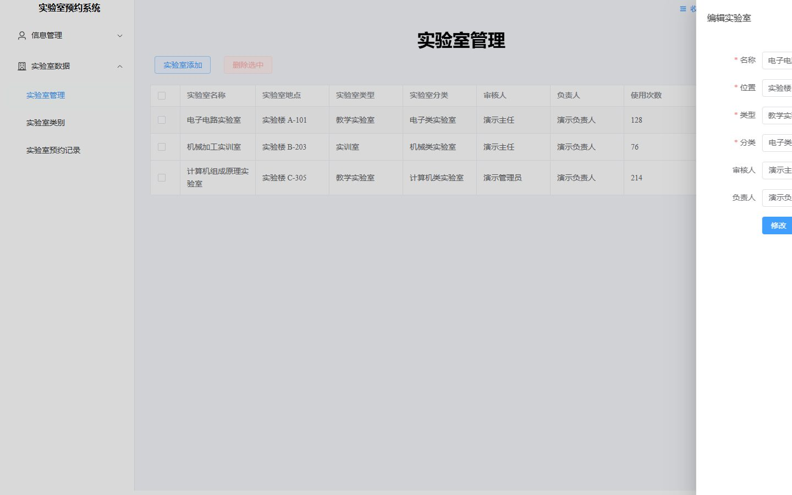

<div align="center">


# 实验室预约系统 · 管理端

基于 **Vue 3 + Element Plus + Vite** 的实验室预约管理端。
内置 **离线 Mock 服务**：克隆后无需任何后端即可登录并浏览、增删改全部演示数据。

[![License][license-shield]][license-url]
[![Vue][vue-shield]][vue-url]
[![Vite][vite-shield]][vite-url]
[![Node][node-shield]][node-url]

**在线演示**：<https://wmh1024.github.io/LaboratoryAdmin-frontend/>
（仓库需在 Settings → Pages 中选择 GitHub Actions，`main` 推送后自动部署）

</div>

## 界面预览

| 登录页                           | 用户管理                               | 编辑抽屉                                 |
| -------------------------------- | -------------------------------------- | ---------------------------------------- |
|  |  |  |

## 功能概览

| 模块                                   | 状态 |
| -------------------------------------- | ---- |
| 管理员登录 / 退出                      | ✅   |
| 用户信息管理（增删改查、分页）         | ✅   |
| 管理员信息管理（增删改查、分页）       | ✅   |
| 实验室管理（增删改查、分页、分类关联） | ✅   |
| 实验室类别（增删改查）                 | ✅   |
| 实验室预约记录（列表、分页、详情）     | ✅   |

> 设备、课表、数据留存/展示、注意事项等未实现模块的页面与菜单入口已移除，仓库只保留可完整运行的模块。

## 快速开始

环境要求：Node.js `^20.19.0` 或 `>=22.12.0`（Vite 8 要求），包管理器 npm（仓库提供 `package-lock.json`）。

```sh
git clone https://github.com/wmh1024/LaboratoryAdmin-frontend.git
cd LaboratoryAdmin-frontend
npm ci

# 必须先复制环境变量示例；否则 VITE_USE_MOCK 为空，Mock 不会启用
cp .env.example .env
# Windows PowerShell / cmd：Copy-Item .env.example .env

npm run dev            # 开发模式（.env 中 VITE_USE_MOCK=true 时使用 Mock）
npm run build:demo     # 纯静态演示构建（含 Mock，可直接静态托管）
npm run build          # 生产构建（排除 Mock，产物在 dist/）
npm run preview        # 预览构建产物
npm run preview:demo   # 以 demo 模式预览 dist/
npm test               # 单元测试（Vitest + jsdom）
npm run test:coverage  # 打印覆盖率基线
npm run smoke          # 构建 demo 并用真实 Chrome 跑关键链路
npm run check:bundle   # 检查生产产物是否混入 Mock
```

Mock 模式下使用固定演示账号登录（登录页会提示）：

| 账号         | 密码       | 角色             |
| ------------ | ---------- | ---------------- |
| `demo_admin` | `demo1234` | 院长（可增删改） |

Mock 服务会校验令牌：除登录外的接口都必须携带有效 `Authorization`，且只有「院长」角色可以写入数据，
因此演示环境与真实后端的鉴权行为一致，不会出现「打开页面就是管理员」的情况。

## 环境变量

| 变量                | 默认值      | 说明                                                                         |
| ------------------- | ----------- | ---------------------------------------------------------------------------- |
| `VITE_API_BASE_URL` | `/api`      | 后端接口基础地址。前后端分离部署时填写完整地址，如 `https://api.example.com` |
| `VITE_USE_MOCK`     | `true`      | 是否启用内置 Mock 服务。**仅对开发服务器生效**，接入真实后端时设为 `false`   |
| `VITE_DEV_HOST`     | `127.0.0.1` | 开发服务器监听地址；容器/远程开发可设为 `0.0.0.0`                            |

### 构建方式

| 命令                                   | 用途                          | Mock                                           |
| -------------------------------------- | ----------------------------- | ---------------------------------------------- |
| `npm run dev`                          | 本地开发                      | 由 `VITE_USE_MOCK` 控制                        |
| `npm run build` / `npm run build:prod` | 对接真实后端的生产构建        | ❌ 强制排除（Mock 代码与种子数据不会进入产物） |
| `npm run build:demo`                   | 纯静态演示（GitHub Pages 等） | ✅ 内置，产物使用相对路径 + hash 路由          |

`.env` 已被 `.gitignore` 忽略，仓库只提交 `.env.example`。生产构建使用 history 路由；
demo 构建使用 hash 路由，部署到任意静态子路径都不需要 404 回退。

> 本项目以**应用**形式分发，`package.json` 的 `private: true` 仅用于防止误发布到 npm，
> 不影响克隆、构建或 fork。

## Mock 说明

- 实现位置：`src/mock/`
    - `index.js`：唯一门面，应用代码只从 `@/mock` 引入
    - `seed.js`：种子数据（全部为虚构数据）
    - `account.js`：演示账号（生产构建不会进入产物）
    - `server.js`：类 REST 路由分发（内存存储，重启后重置）
    - `browser.js`：axios 适配器，浏览器内直接使用同一套路由
- 生产构建通过 Vite alias 把精确路径 `@/mock` 替换为 `src/__mock_disabled__.js`，
  并用 `npm run check:bundle` 做结构性断言（禁止种子数据、演示凭据与子路径绕过）
- 同时提供 Vite 中间件（`build/mock-plugin.js`），`/api/*` 请求在开发服务器阶段即可响应
- 新增接口时，请同步补充 Mock 路由，保证“无后端也能运行”

Mock 数据脱敏约定：学号为虚构号段，姓名为虚构姓名，手机号 `199-0000-xxxx`，
邮箱统一使用 `example.com`，地点使用“实验楼 A-101”等虚构地址。

## 接口约定

完整契约（字段、枚举、错误码、请求/响应示例）见 **[docs/API.md](./docs/API.md)**，本文件与 `src/api/*`、`src/mock/*` 均以此为准。

- 响应结构：`{ code: number, msg: string, data: any }`，`code === 200` 视为成功，失败时 HTTP 状态与业务码一致
- 分页数据：`data = { items: T[], counts: number }`，请求参数为 `page` / `pageSize`
- 认证：登录返回 `data.token`，前端以 `Authorization: Bearer <token>` 携带；令牌无效返回 `401`
- 权限：写接口（add/update/delete）仅「院长」（`status === 0`）可调用，否则返回 `403`
- 批量删除：`DELETE .../delete?ids=1,2,3`，`ids` 为必填的逗号分隔正整数
- 密码为只写字段：可随新增/修改提交，任何响应都不会返回 `password`

| 方法                | 路径                                                                                                             | 说明                     |
| ------------------- | ---------------------------------------------------------------------------------------------------------------- | ------------------------ |
| POST                | `/admin/login`                                                                                                   | 管理员登录               |
| POST                | `/admin/logout`                                                                                                  | 退出登录（作废当前令牌） |
| GET/POST/PUT/DELETE | `/user/list` `/user/find/{id}` `/user/add` `/user/update` `/user/delete`                                         | 用户增删改查             |
| GET/POST/PUT/DELETE | `/admin/list` `/admin/find/{id}` `/admin/add` `/admin/update` `/admin/delete`                                    | 管理员增删改查           |
| GET/POST/PUT/DELETE | `/lab/category/list` `/lab/category/find/{id}` `/lab/category/add` `/lab/category/update` `/lab/category/delete` | 实验室类别               |
| GET/POST/PUT/DELETE | `/laboratory/list` `/laboratory/find/{id}` `/laboratory/add` `/laboratory/update` `/laboratory/delete`           | 实验室                   |
| GET                 | `/laboratory/record/list` `/laboratory/record/find/{id}`                                                         | 实验室预约记录           |

## 技术栈

- Vue 3.5（组合式 API，使用 `defineModel`）+ Vue Router
- Element Plus（按需自动引入）
- Pinia（登录态持久化）
- Axios（统一请求/响应拦截）
- Vite + Sass

## 开发规范

- 静态检查：`npm run lint`（ESLint 9 + eslint-plugin-vue），格式化：`npm run format`（Prettier）
- 单元/组件测试：`npm test`（Vitest + jsdom + @vue/test-utils），覆盖 API 工具、composable、Mock 服务与关键页面
- 浏览器冒烟：`npm run smoke`（playwright-core 驱动系统 Chrome，验证登录、列表与编辑闭环）
- 覆盖率基线：`npm run test:coverage`；生产产物隔离：`npm run check:bundle`
- 提交前请确保 `npm run lint`、`npm run format:check`、`npm test`、`npm run build`、`npm run check:bundle` 全部通过
  （涉及 UI 时再跑 `npm run smoke`；CI 会自动检查）
- 依赖安装建议使用 `npm ci`，以保证与 `package-lock.json` 完全一致
- 详见 [CONTRIBUTING.md](./CONTRIBUTING.md) 与 [CODE_OF_CONDUCT.md](./CODE_OF_CONDUCT.md)

## 部署

| 场景                 | 命令                                       | 产物                         | 注意事项                                     |
| -------------------- | ------------------------------------------ | ---------------------------- | -------------------------------------------- |
| 对接真实后端         | `npm run build`（或 `npm run build:prod`） | `dist/`                      | Mock 已被构建期剔除，可用 CI 断言校验        |
| 纯静态演示（无后端） | `npm run build:demo`                       | `dist/`（`base` 为相对路径） | 含 Mock 与演示账号，**请勿当作生产环境部署** |

> `npm run preview` 预览 demo 时同样可用；若直接 `scp dist/` 部署，请先确认所用的是哪种构建。
> 部署细节、SPA 回退与 Nginx 安全响应头示例见 [docs/DEPLOYMENT.md](./docs/DEPLOYMENT.md)。
> GitHub Pages 演示由 `.github/workflows/deploy-demo.yml` 自动构建并部署 `build:demo` 产物。

## 参与贡献

1. Fork 本仓库
2. 新建分支：`git checkout -b feat/your-feature`
3. 提交改动：`git commit -m 'feat: your feature'`
4. 推送分支并发起 Pull Request

## 安全

请勿在仓库中提交真实个人信息、内网地址或账号密码；发现安全问题请参见 [SECURITY.md](./SECURITY.md)。

## 许可证

本项目基于 [MIT License](./LICENSE) 开源。媒体资源授权见 [docs/ASSETS.md](./docs/ASSETS.md)。

当前版本：`0.1.0`（版本记录见 [CHANGELOG.md](./CHANGELOG.md)）。

<!-- links -->

[license-shield]: https://img.shields.io/github/license/wmh1024/LaboratoryAdmin-frontend.svg?style=flat-square
[license-url]: ./LICENSE
[vue-shield]: https://img.shields.io/badge/Vue-3.x-42b883?style=flat-square&logo=vue.js
[vue-url]: https://vuejs.org/
[vite-shield]: https://img.shields.io/badge/Vite-8.x-646cff?style=flat-square&logo=vite
[vite-url]: https://vite.dev/
[node-shield]: https://img.shields.io/badge/Node-%3E%3D20.19-339933?style=flat-square&logo=node.js
[node-url]: https://nodejs.org/
